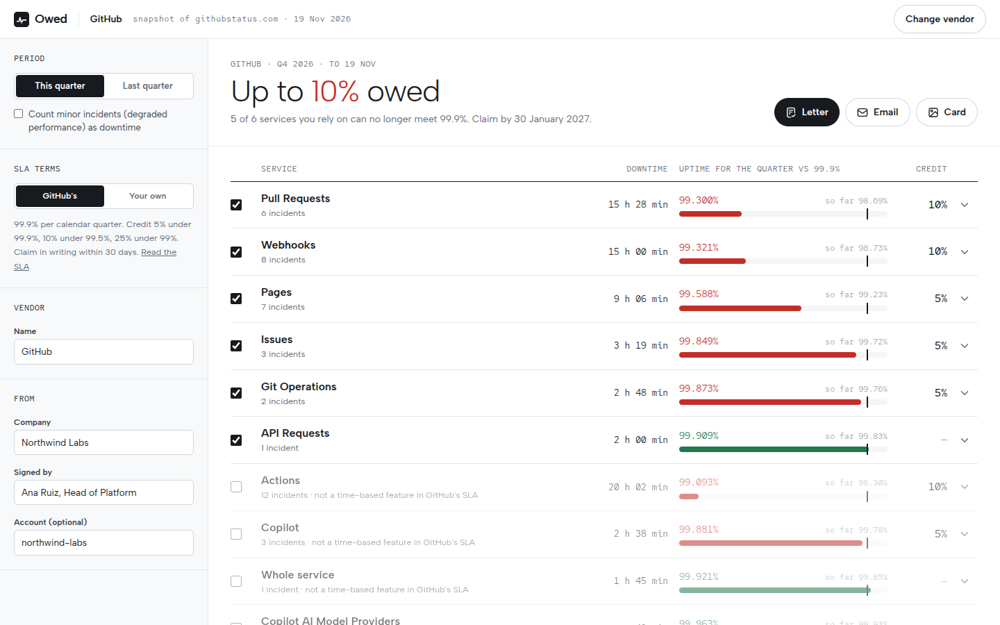
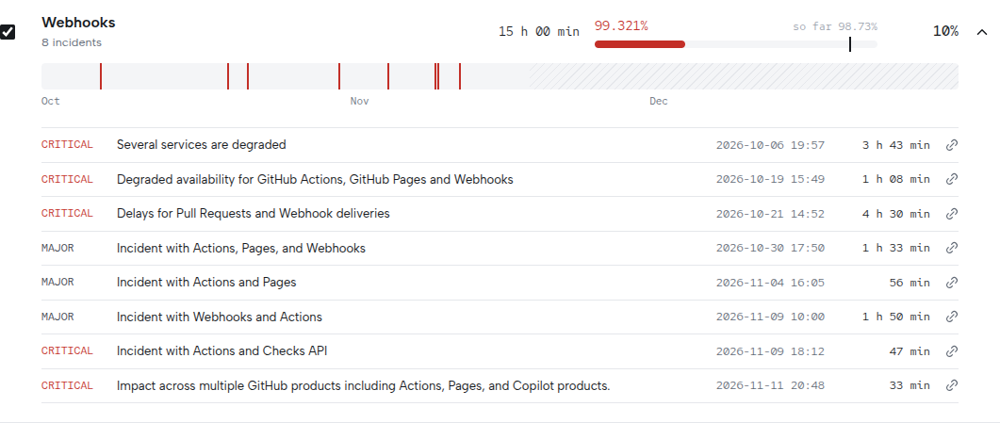
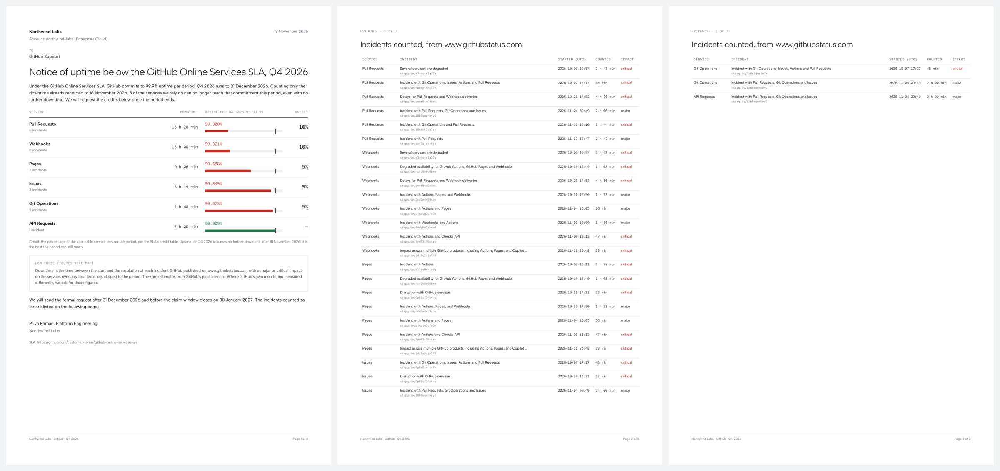
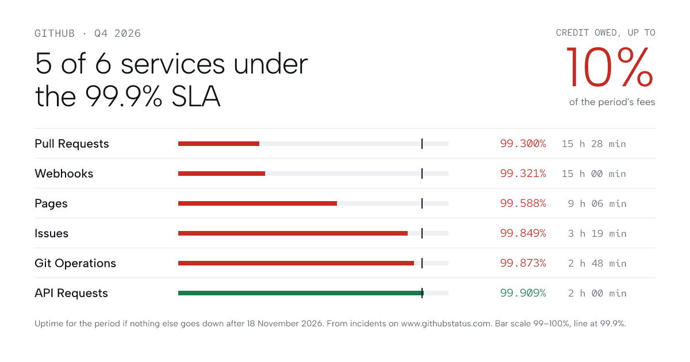
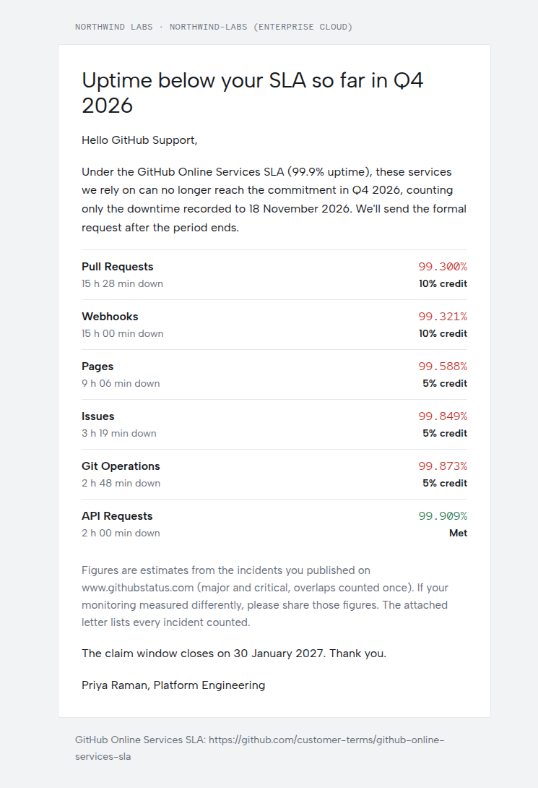

# Owed

**The SLA credit your vendor owes you, from its own status page.** Point Owed at a vendor's public status page. It
works out each service's uptime for the SLA period, compares it with the uptime commitment, finds the credit tier, and
writes three things: a claim letter (PDF) with every incident as evidence, an email to the vendor's support, and a
card (PNG) for your team channel.

Built with [Hyper Elements](https://github.com/hyper-elements/hyper-elements) for the Hyper Elements Template Challenge.

**Live:** https://owed.rohitkashyapmrt.workers.dev



## Why this exists

SaaS vendors promise uptime in an SLA and owe a credit when they miss it. But the customer has to notice the miss and
ask in writing, in time, with numbers.

GitHub's [Online Services SLA](https://github.com/customer-terms/github-online-services-sla) (June 2026 version) says:

- "GitHub commits to maintain at least 99.9% Uptime", per calendar quarter.
- Credits: **5%** of the fees for 99.5% to 99.9%, **10%** for 99.0% to 99.5%, **25%** under 99.0%.
- "Customer may redeem Service Credits only upon written request within thirty (30) days of the end of the Applicable
  Period."

Developers notice the misses and don't know what happens next. On
[Hacker News, March 2026](https://news.ycombinator.com/item?id=47490020): "none of the individual services has hit 3x9
uptime in the last 90 days, which is their Enterprise SLA" and "Is there a meaningful fallout when these services fail
to meet their SLAs?"

The data to answer it is public. Atlassian Statuspage, which GitHub, OpenAI, Cloudflare and many others use, publishes
every incident with its impact, start, resolution and affected components at `/api/v2/incidents.json`.

**What it found (our calculation, 19 Nov 2026):** counting GitHub's major and critical incidents in Q4 2026 so far,
Pull Requests can reach at best 99.300% for the quarter and Webhooks 99.321%: both are already in the 10% tier, even if
nothing else goes down this quarter. Pages, Issues and Git Operations are in the 5% tier.

## How it works

| Step | What happens |
|---|---|
| **Pick the vendor** | GitHub, OpenAI and Cloudflare are one click. Paste any Statuspage address, or upload an incident CSV from your own monitoring. A saved copy of githubstatus.com (19 Nov 2026) is included, so the numbers above can be checked. |
| **Read the ledger** | Every service, its downtime this period, its uptime against the SLA line, and the credit its tier gives. Open a row to see each incident on the period's timeline, with its link. |
| **Send the claim** | Tick the services you rely on, add your company and who signs it, then preview and download the letter, the email and the card. |



The letter (A4): the request, then the evidence pages.



| Card for the team | Email to support |
|---|---|
|  |  |

The landing page (7 sections, with an FAQ): [media/landing.png](media/landing.png). The dashboard on a phone:
[media/mobile.png](media/mobile.png).

## Honest numbers

A claim with inflated numbers gets ignored, so Owed counts carefully and every letter says how:

- **Downtime** is each incident's start to its resolution, with overlaps counted once and clipped to the period.
- **Major and critical incidents count.** Minor ones (degraded performance) count only if you switch them on.
- **Before the period ends**, uptime is shown "at best": the most the period can still reach with no more downtime.
  The letter is then a *notice*, and it becomes the *claim* once the period is over.
- **Only time-based services.** GitHub's SLA measures Actions by executions that failed to run and Packages by failed
  storage transactions, not by minutes. A status page can't show that, so they start unticked.
- **Missing history is said out loud.** A Statuspage feed holds the latest 50 incidents. If they don't reach back to
  the start of the period, Owed shows "Not enough data for this period" and turns the letter off.
- **The vendor's monitoring decides.** The figures are estimates from the vendor's public record, and the letter asks
  for the vendor's own data if it differs.

## How Hyper Elements is used

The three outputs are **Hyper Elements templates** in `templates/`. The app renders them in the browser
(`src/lib/render-route.ts`, so the site runs on Cloudflare with no render server), and the CLI renders the same files.

- **Typed fields with rules** (`templates/_shared/claim.tsx`). The status page and SLA link must be `http(s)` URLs, the
  commitment is between 90 and 100, dates are dates, credits are 0 to 100, there are 1 to 20 services and at most 400
  incidents, and impact is one of `minor`, `major` or `critical`. A value outside the rules stops the render with the
  field and the reason (the app shows it; the API answers 422 with the diagnostics).
- **`<Document>` + `renderPdf()`** for the letter. Page 1 has a row per service with an uptime bar drawn with `Svg`
  and `Rect` (99% to 100%, with the commitment marked). The evidence is a `Table`, 24 incidents to a page between
  `PageBreak`s, and a `PageFooter` with `PageNumber`. One `final` field switches the wording between notice and claim.
- **`<Canvas>` + `renderImage()`** for the 1200 × 630 card, with the `image/overflow`, `image/glyph` and `image/fit`
  rules required, so a long service name can't spill or lose a glyph.
- **`<Email>`** with a `defineTheme()` theme and named styles, checked by lint (`lang`, `contrast`, `link-text`) and
  the email client checks, with preview text required.
- **Values files + CLI:** `npm run claims` turns `claims/github-q4-2026.json` into values files with
  `hyper-elements design new`, then renders them with `hyper-elements render`.

## Run it

Needs Node 22.6+.

```bash
npm install
npm run dev            # http://localhost:3000 (landing) and /claim (the dashboard)
```

In the dashboard, pick a vendor, paste a status page, upload a CSV, or press **GitHub, frozen on 19 Nov 2026**.

```bash
npm test               # periods, credit tiers, the real feed, overlap merging, CSV import (5 tests)
npm run check          # check the three templates with their example
npm run claims         # claims/github-q4-2026.json → out/claims/ (letter PDF, email, card)
npm run preview:email  # the email as each email client draws it
npm run build && npx wrangler dev   # the static site, served the way Cloudflare does
```

### Incident CSV

A header row, then one incident per row. `start` and `end` (ISO 8601) and `service` are needed; `title`, `impact`
(`minor`, `major`, `critical`; missing = `major`) and `link` are optional. See `public/samples/incidents-format.csv`.

```csv
start,end,service,title,impact,link
2026-11-03T08:12:00Z,2026-11-03T09:40:00Z,Payments API,Sample: elevated 5xx on charges,major,
```

## Project layout

```
templates/_shared/sla.ts      periods, merging downtime windows, uptime, credit tiers, deadlines (no imports)
templates/_shared/claim.tsx   the claim's fields, look and helpers
templates/_shared/example.ts  the sample: GitHub's real Q4 2026 data, claimed by a made-up company
templates/letter.tsx          <Document>: the notice or claim letter, with evidence pages
templates/email.tsx           <Email>: the message to the vendor's support
templates/card.tsx            <Canvas>: the card for the team channel
src/lib/sources.ts            reads a Statuspage (incidents + components) or an incident CSV
src/lib/claim.ts              the ledger for a period, and the values the templates take
src/components/Ledger.tsx     the dashboard: start screen, setup rail, ledger, output drawer
src/app/page.tsx              the landing page
public/samples/               the saved githubstatus.com feed and the CSV format sample
claims/                       the sample claim and its values files for the CLI
tests/                        sla, feed and CSV tests
```

## Sample data

The GitHub incidents are real: `public/samples/githubstatus-2026-11-19.json` is githubstatus.com's public
`incidents.json` and `components.json`, saved on 19 November 2026. "Northwind Labs" and the people who sign its
letters are made up. Owed is not affiliated with GitHub or any vendor shown; vendor names are used only to name their
public status pages.

## License

MIT for the code. Fonts: Albert Sans and Red Hat Mono, SIL Open Font License 1.1 (`fonts/OFL-*.txt`).
